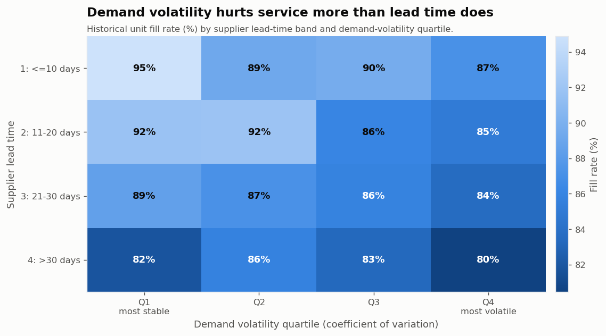
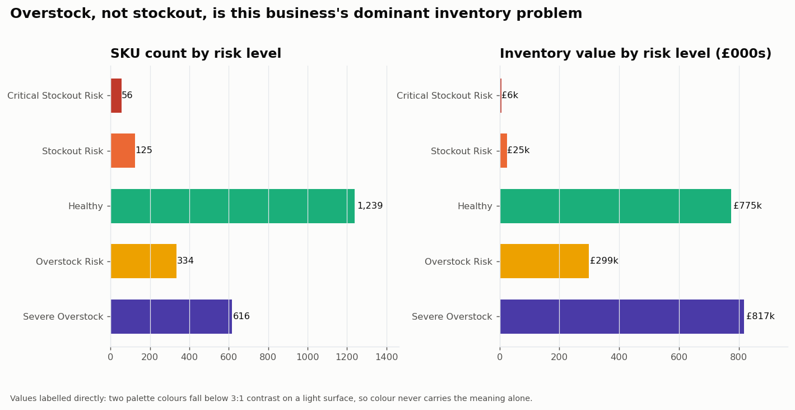
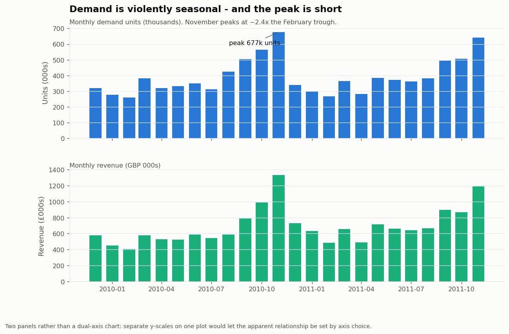
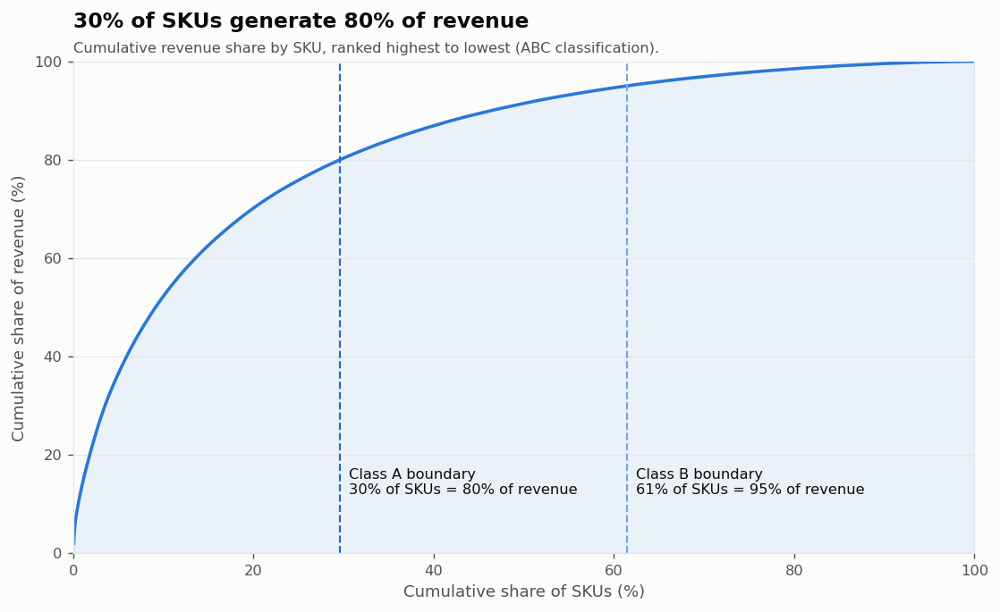
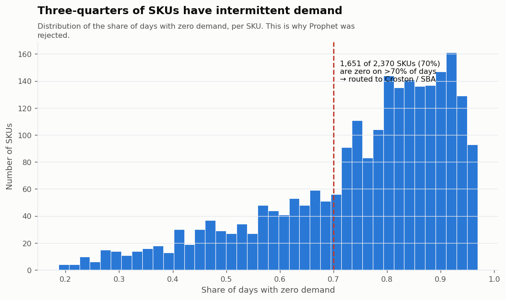
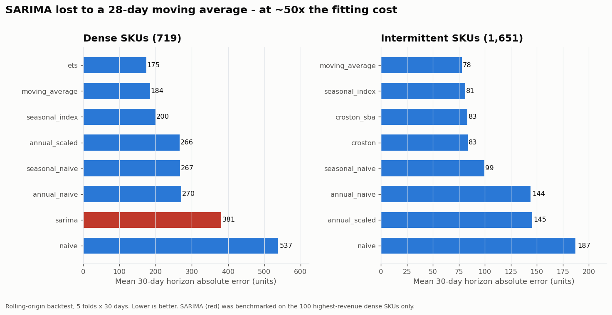
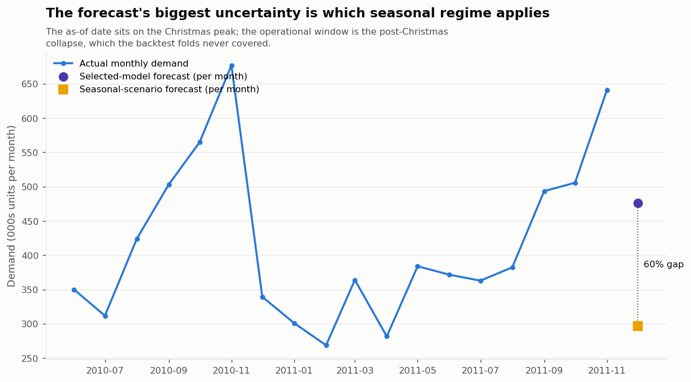
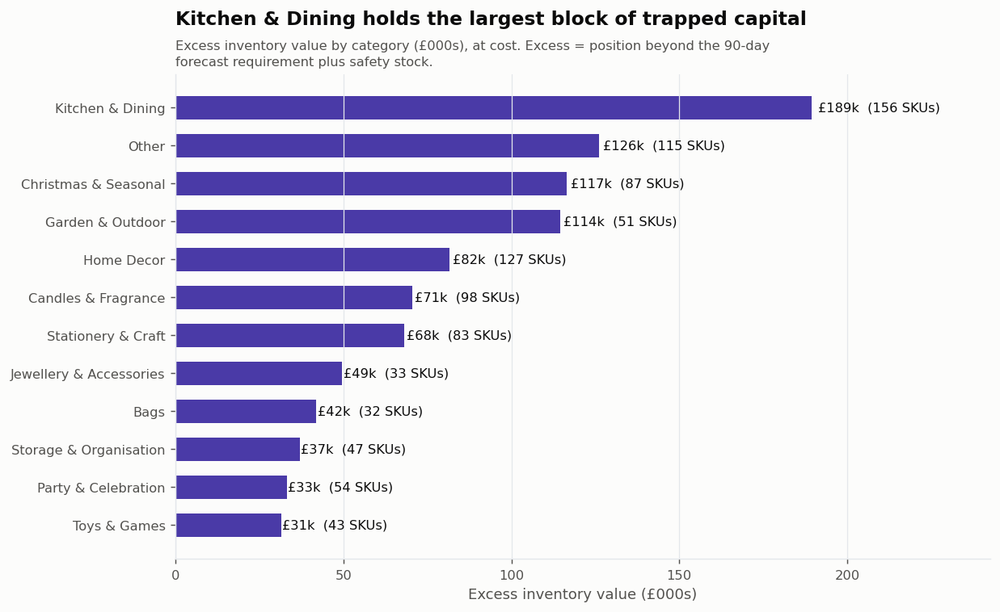

# Inventory Stockout & Overstock Early-Warning System

An end-to-end analytics system that tells a retail business **which SKUs to
reorder, which to mark down, and what each decision is worth** — built on
1.07M real transactions from a UK online giftware wholesaler.

`SQL` · `Python` · `Pandas` · `DuckDB` · `statsmodels` · `Power BI`

---

## The business problem

Inventory fails in two directions at once, and most businesses only measure one.

**Stock out** and you lose the sale, the margin, and sometimes the customer.
**Overstock** and you have converted cash into boxes that cost money to store,
age badly, and eventually get marked down.

A planner reviewing 2,370 SKUs every week cannot hold both risks in their head.
This system answers, for every SKU, every week:

1. Is this going to run out before the next delivery arrives?
2. Is there more of this than we can realistically sell?
3. How much money is that worth?
4. What should we actually do about it — and in what order?

## Headline results

Measured across 2,370 active SKUs as at 2011-12-09:

| Finding | Value |
| --- | --- |
| Excess inventory identified | **£979k** across 950 SKUs (51% of inventory value) |
| Dead stock isolated | **£242k** across 265 SKUs with ~zero forward demand |
| SKUs at critical stockout risk | **56**, with per-SKU reorder quantities |
| Revenue at risk from those stockouts | **£63k** (estimate) |
| Incumbent policy fill rate | **90.6%** vs a 95% target |
| Forecast accuracy | median **MASE 0.883**; 56% of SKUs beat a naive forecast |
| Inventory turnover | 2.21x (165 days of stock) |

**The strategic finding:** demand *volatility* damages service more than supplier
*lead time* does — fill rate falls 94.8% → 75.3% across volatility quartiles but
only 89.6% → 83.1% across sourcing regions. The incumbent policy already covers
quoted lead times but carries no buffer for demand variability. **The largest
service gains come from sizing safety stock to volatility, not from chasing
shorter lead times** — which redirects where the business spends effort.



*Read across a row: service barely moves. Read down a column: it collapses.
Both gradients exist, but volatility is the steeper one — and it is the one the
incumbent policy leaves completely unbuffered.*



*Overstock dominates: 950 SKUs and £1.1M of inventory value sit above the
requirement line, against 181 SKUs short. Note the asymmetry between the two
panels — Critical Stockout Risk is 56 SKUs but only £6k of stock, because the
problem there is the absence of inventory, not its value.*

---

## ⚠️ Data provenance — read this before interpreting any number

| Layer | Provenance |
| --- | --- |
| **Demand** — transactions, quantities, prices, dates, returns | **REAL** — UCI *Online Retail II* |
| **Category** | **DERIVED** — keyword ruleset over product descriptions, audited at 93% |
| **Inventory position, unit cost, supplier, lead time** | **SIMULATED** — documented assumptions |

No public dataset pairs real transaction-level demand with real inventory
positions. Rather than fabricate inventory at random, the inventory ledger is
**reconstructed by running a documented replenishment policy against the real
demand series**. Inventory is therefore a deterministic function of real demand
plus a stated policy — a historical stockout means *"this ordering rule could not
cover the demand that genuinely occurred on that date"*, not *"a random number
was small"*.

Full parameter table, rationale and reproducibility notes:
**[`reports/ASSUMPTIONS.md`](reports/ASSUMPTIONS.md)**.

Swap `data/processed/inventory_daily.parquet` for a real inventory feed and every
downstream module runs unchanged. The simulation is scaffolding, not the product.

---

## Dataset

**UCI Online Retail II** — a UK-based online giftware wholesaler.

| | |
| --- | --- |
| Raw rows | 1,067,371 |
| Period | 2009-12-01 → 2011-12-09 (739 calendar days, 604 trading days) |
| Raw stock codes | 5,304 |
| Countries | 43 (91.9% United Kingdom) |
| After cleaning | 1,005,780 sales lines, 4,773 product SKUs |
| Operational scope | **2,370 SKUs — 49.7% of the catalogue, 86.1% of revenue** |

Download: [UCI ML Repository — Online Retail II](https://archive.ics.uci.edu/dataset/502/online+retail+ii).
Place `online_retail_II.xlsx` in `data/raw/`.



*November peaks at ~2.4× the February trough, and demand collapses to 34.9% of
peak in the month after Christmas. That collapse is the single most important
fact for the forecast, because the as-of date sits directly on the peak.*



*Revenue is heavily concentrated: 701 A-class SKUs (30% of the operational
catalogue) generate 80% of revenue. This is the argument for differentiating
service levels by ABC class rather than applying one target across the board.*

---

## Methodology

```
Raw Excel (2 sheets)
   ↓  data cleaning ....... 22 documented quality findings
Clean transactions + demand panel
   ↓  supply simulation ... cost, supplier, lead time, daily inventory ledger
DuckDB analytical layer .... 14 SQL invariant assertions, all passing
   ↓  EDA ................. 8 figures, each answering a stated question
   ↓  forecasting ......... 10 models, rolling-origin backtest, 5 folds
Demand forecast (7/14/30/60/90 day)
   ↓  safety stock ........ demand + lead-time variability
   ↓  reorder point ....... protection interval = lead time + review period
   ↓  risk classification . 5 levels on scale-free ratios
   ↓  financial impact .... lost revenue / excess capital / margin at risk
   ↓  priority score ...... transparent weighted, decomposable
Action recommendations  →  Power BI star schema
```

### 1 · Data cleaning — the finding that changes everything

The workbook's two sheets **overlap on 2010-12-01…09**. The overlapping rows are
an identical multiset — the same nine trading days exported into both sheets.

Concatenating them naively, which most published analyses of this dataset do,
**doubles demand for those nine days**:

| Date | Naive concat | After treatment | Inflation |
| --- | --- | --- | --- |
| 2010-12-01 | 54,014 | 26,906 | **+100.8%** |
| 2010-12-02 | 62,696 | 31,283 | **+100.4%** |
| 2010-12-07 | 50,730 | 25,324 | **+100.3%** |

Left untreated this corrupts every trailing average, seasonal index and
safety-stock estimate that touches December 2010.

Other treatments, all logged with counts, treatment and rationale in
[`reports/data_quality_report.md`](reports/data_quality_report.md):

- **11,812** exact duplicate transaction lines removed
- **3,399** negative-quantity rows separated as *warehouse write-offs*
  (`lost`, `damages`, `wrongly coded`, `printing smudges/thrown away`) — these
  are stock adjustments, **not** demand, and counting them as negative demand
  would understate true demand and corrupt demand variability
- **19,103** customer cancellations netted against gross demand
- **4,753** service/fee codes (`POST`, `DOT`, `AMAZONFEE`, `BANK CHARGES`,
  gift vouchers, `TEST*`) excluded — they are not stockable inventory
- **170** stock codes differing only by letter case merged
- **983** extreme bulk orders **retained and flagged**, not deleted — this is a
  wholesaler, and deleting genuine bulk demand would understate the reorder
  point for exactly the SKUs where a stockout costs most

**Category is derived, and the derivation is measured.** A 60-SKU random sample
was hand-audited: **56/60 correct (93%)**. The audit found and fixed two real
bugs — an unanchored `"PEN "` matched *O(**PEN S**)HAPE*, and `"BIRD"` captured
*LOVEBIRD HANGING DECORATION* into Garden & Outdoor.

### 2 · SQL analytical layer

Six scripts in [`sql/`](sql/) building the analytical tables in DuckDB — product
performance, ABC classification, demand statistics, inventory position and
turnover, stockout episodes (gaps-and-islands), overstock detail, and the
dashboard star schema.

`01_data_quality.sql` re-verifies the Python pipeline **in a different engine**:
14 invariant assertions (ledger flow identity, no sheet overlap, complete
SKU×day grid, no negative inventory, cost below price). All pass.

One bug this caught: stockout episodes were initially counting **pre-launch
periods** as outages, producing 474-day phantom stockouts for SKUs that did not
exist yet. Restricting to each SKU's active life corrected the median episode
length from an artefact to **12 days**.

### 3 · Demand forecasting

**74.9% of SKU-days have zero demand.** That single fact drives every choice.



*1,651 of 2,370 SKUs are zero on more than 70% of days. This is the evidence
behind every modelling decision below — it is not a dataset that smooth
trend-and-seasonality models were designed for.*

**Prophet was rejected — on evidence, not preference.** It models a smooth trend
plus smooth seasonalities; fitted to a series that is zero four days in five it
produces smooth drift that is neither accurate nor interpretable, at ~50x the
cost of the methods that won.

Ten models compared: naive, seasonal naive, moving average, annual naive, annual
scaled, seasonal index, Croston, Croston-SBA, ETS/Holt-Winters, SARIMA.

**Validation:** rolling-origin backtest, 5 folds × 30 days. Fold *k* trains only
on `demand[:origin]`. Never a random split; no lookahead anywhere.

**Selection metric:** error on the **30-day horizon total**, not the daily path —
a reorder quantity is built from a total, not a sequence.

| Model | Dense SKUs | Intermittent SKUs |
| --- | --- | --- |
| ETS | **175** | — |
| moving average | 184 | **78** |
| seasonal index | 200 | 81 |
| Croston-SBA | — | 83 |
| SARIMA | 381 | — |
| naive | 537 | 187 |

*Mean 30-day horizon absolute error, units. Lower is better.*



**SARIMA did not earn its cost.** On the 100 highest-revenue dense SKUs it was
beaten by a 28-day moving average (381 vs 184) at ~50x the fitting time, so it
was not rolled out to all 2,370 SKUs. Benchmarking on a sample and rejecting on
evidence is the engineering decision.

**Accuracy:** median MASE **0.883**; **56.2%** of SKUs beat a naive forecast.
Median sMAPE is 153% and is reported anyway — with 75% zero days, any non-zero
forecast against a zero actual scores 200%. That is exactly why sMAPE is not the
selection metric. MAPE is undefined here and is not used.

**The uncertainty that could not be validated away.** The as-of date sits on the
Christmas peak; the operational window is the post-Christmas collapse (demand
fell to **34.9%** of peak over the equivalent window a year earlier). Every
backtest fold falls in the ramp-up, so model selection has no evidence about
post-peak behaviour — and with only two years of history a seasonal model cannot
be validated on that regime (it needs one year to learn the season and a second
to be tested on it). **Both scenarios are therefore published side by side**
rather than silently picking one:

| Horizon | Selected model | Seasonal scenario | Gap |
| --- | --- | --- | --- |
| 30 days | 454,702 units | 268,433 units | +69.4% |
| 90 days | 1,427,665 units | 890,491 units | +60.3% |



*Plotted at the 90-day horizon, converted to a monthly rate for comparability
with the history line. The selected model carries the current level forward; the
seasonal scenario applies last year's post-Christmas shape. Neither can be
validated on this regime, so both ship — and the gap is labelled as uncertainty
rather than dressed up as precision.*

### 4 · Safety stock & reorder point

The textbook `z · σ_d · √LT` assumes deterministic lead time. It is not —
supplier lead-time SD ranges 1.0–8.0 days. The combined form is used:

```
SS  = z · √( PI · σ_d²  +  d̄² · σ_LT² )
ROP = d̄ · PI + SS          PI = lead_time + review_period
```

- **Service level** 95% → z = 1.645 (one line in `config/config.yaml` to change)
- **d̄** comes from the *forecast* (forward-looking), σ_d from the trailing 90 days
- **Protection interval** includes the review period: after a review you cannot
  order again until the next one
- All comparisons use **inventory position** (on-hand + on-order), never on-hand
  alone — that is the classic double-ordering bug

Modelling lead-time variability adds **11%** to safety stock for Far-East SKUs
versus **3%** for UK domestic — it protects exactly the SKUs most exposed.

Verified by hand: SKU 22423, PI = 31d, σ_d = 36.43, σ_LT = 2.32 →
hand-calculated SS 337.10 vs module 337.00.

### 5 · Risk classification

| Level | Rule | SKUs |
| --- | --- | --- |
| 🔴 Critical Stockout Risk | cover ratio < 0.50 | 56 |
| 🟠 Stockout Risk | cover ratio < 1.00 | 125 |
| 🟢 Healthy | — | 1,239 |
| 🟡 Overstock Risk | excess ratio > 1.5 | 334 |
| 🟣 Severe Overstock | excess ratio > 3.0 | 616 |

Ratios are scale-free so a £0.40 sticker and a £12 cakestand are judged alike.

**The 90-day overstock horizon is justified, not assumed.** This business turns
inventory 2.2x a year; judging excess against a 30-day requirement flags 78% of
SKUs and produces an unusable alert list. Full sensitivity at 30/60/90 days and
1.5/2/3x thresholds is published in
[`overstock_threshold_sensitivity.csv`](outputs/business_insights/overstock_threshold_sensitivity.csv).

**Materiality floors** keep the list usable: a ratio breach worth £4 is noise.
SKUs below the floor keep their risk level for reporting but are excluded from
the action list — **939 of 2,370 SKUs are actionable**.

**Dead stock is separated from overstock.** A SKU holding 4,406 units against a
90-day forecast of 4 units has not been over-ordered — it has stopped selling.
The action is liquidation, not a smaller reorder.



*Where the trapped capital actually sits (bar labels show the number of
overstocked SKUs). Kitchen & Dining carries the largest block at £189k from 156
SKUs — but Garden & Outdoor is the sharper problem: £114k from just 51 SKUs, and
the category runs a median 425 days of cover against 74 for Kitchen & Dining.
That is a small, deeply seasonal range being held through the wrong season.*

### 6 · Prioritisation score — transparent, not a black box

A weighted sum of percentile-ranked components, weights declared in
`config/config.yaml`. Percentile ranks are used because the raw distributions are
extremely skewed — one SKU with £50k exposure would otherwise dominate.

Every score decomposes back into its parts:

```
METAL SIGN TAKE IT OR LEAVE IT        score 91.52
  financial_exposure    40.00
  severity              25.00
  velocity              15.00
  revenue_contribution   9.89
  lead_time_pressure     1.63
  ─────────────────────────────
  SUM                   91.52  ✓
```

### 7 · Action recommendation engine

| Action | Priority | SKUs | Value |
| --- | --- | --- | --- |
| Markdown / Clearance | P2 | 376 | £558k |
| Liquidate (dead stock) | P2 | 265 | £242k |
| Reduce Replenishment | P3 | 313 | £186k |
| Reorder Now | P1 | 34 | £36k |
| Expedite Reorder | P1 | 22 | £20k |
| Reorder | P2 | 125 | £7k |

Every recommendation carries the numbers that produced it:

> **PINK ROSE WASHBAG** — Severe Overstock, P2
> *Clear 4,406 units (£8,636 at cost) through clearance, bundling or write-off. Do not reorder.*
> **Why:** 90-day forecast demand is 0 units against 4,406 on hand — the SKU has effectively stopped selling.

---

## Dashboard

Power BI star schema, complete DAX measure library, and a page-by-page build
specification in [`dashboard/powerbi/`](dashboard/powerbi/).

> **Why no `.pbix`?** It is a proprietary compiled binary that cannot be authored
> outside Power BI Desktop. What ships instead is the entire semantic layer — the
> star-schema tables, every measure, and the exact visual spec.

<!-- ---------------------------------------------------------------------
     DASHBOARD SCREENSHOTS — add after building the report.

     Save PNGs to outputs/figures/dashboard/ using these names, then delete
     this comment block and uncomment the four image lines below.
     Capture at 1280x720 with all slicers cleared so the figures match the
     numbers quoted in this README.
     -------------------------------------------------------------------- -->

<!--


-->

*Screenshots are added once the report is assembled from
[`BUILD_GUIDE.md`](dashboard/powerbi/BUILD_GUIDE.md). The analysis figures
throughout this README are generated directly by the pipeline
(`python -m src.eda`) and regenerate on every run.*

**Page 1 · Executive Overview** — 7 KPI cards (SKUs, stockout/overstock counts,
est. lost revenue, excess value, turns, days of inventory); risk distribution;
demand vs inventory trend; excess by category; risk scatter map.

**Page 2 · Stockout Risk** — the reorder priority list: current position, reorder
point, cover ratio, lead time, forecast, est. lost revenue and **order quantity**,
ranked by priority score. Answers *"which products do I reorder first?"*

**Page 3 · Overstock Risk** — capital-release opportunities: excess units and
value, days of cover, dead-stock flag. Answers *"where is capital tied up?"*

**Page 4 · Forecast & Demand** — history vs forecast with empirical 80% intervals,
the two seasonal scenarios side by side, model-selection counts, and an accuracy
scatter with a MASE = 1 reference line. Drill-down Category → Product → Forecast.

**Design decisions:** the five risk colours were chosen by running a
colour-vision-deficiency validator (worst adjacent ΔE 19.1 against a ≥12 target);
two of them fall below 3:1 contrast so every visual using them carries direct
data labels. **No dual-axis charts anywhere** — two y-scales let axis choice
manufacture an apparent relationship, so paired measures are drawn as two aligned
panels instead.

---

## Repository structure

```
inventory-risk-analytics/
├── config/config.yaml          every business assumption and threshold
├── data/{raw,interim,processed}
├── sql/                        01 quality · 02 sales · 03 inventory
│                               04 stockout · 05 overstock · 06 dashboard
├── src/
│   ├── config.py               YAML config + path resolution
│   ├── data_cleaning.py        cleaning pipeline + DQ log
│   ├── categorization.py       derived category ruleset
│   ├── supply_simulation.py    cost/supplier/lead time + inventory ledger
│   ├── database.py             DuckDB layer
│   ├── forecasting.py          10 models, rolling-origin backtest
│   ├── inventory_metrics.py    safety stock, reorder point, coverage
│   ├── risk_scoring.py         classification + priority score
│   ├── recommendations.py      action engine
│   ├── eda.py                  figures
│   └── reporting.py            markdown report generation
├── notebooks/                  01 cleaning · 02 EDA · 03 forecasting · 04 risk
├── dashboard/powerbi/          data/ · measures.dax · BUILD_GUIDE.md
├── outputs/                    figures · forecasts · risk_tables · insights
├── reports/                    data_dictionary · data_quality_report · ASSUMPTIONS
├── run_pipeline.py             end-to-end runner
└── requirements.txt
```

## Reproducing

```bash
pip install -r requirements.txt
# place online_retail_II.xlsx in data/raw/
python run_pipeline.py                    # full rebuild, ~5 min
python run_pipeline.py --skip-forecast    # reuse cached forecasts, ~15 s
```

Everything is seeded from `config/config.yaml` (`random_seed: 42`) and
reproduces byte for byte.

---

## Business recommendations

1. **Release £979k of working capital.** Over half of inventory value sits beyond
   a 90-day forward requirement. Start with the 376 Severe Overstock SKUs (£558k)
   where a clearance is defensible on margin.
2. **Liquidate 265 dead-stock SKUs (£242k)** whose forward demand is effectively
   zero. This is a write-down decision, not a replenishment decision, and
   conflating the two is why the stock is still there. (261 of these also breach
   the overstock ratio; 4 sit inside the healthy band on ratio alone, which is
   exactly why dead stock is flagged independently of the ratio test.)
3. **Size safety stock to demand volatility, not lead time.** Volatility explains
   more service variance than sourcing region does. Adopting the combined
   safety-stock formula at a 95% service level closes most of the 90.6% → 95%
   fill-rate gap.
4. **Expedite the 22 critical SKUs on long lead times** before the ordinary
   reorder cycle — a 38-day Far-East lead time cannot be recovered inside one
   weekly review.
5. **Differentiate service level by ABC class.** The 701 A-class SKUs generate
   80% of revenue yet only 29 of them sit in stockout risk, while 87 C-class SKUs
   do. A uniform 95% target over-invests in the long tail and under-protects the
   SKUs that actually carry the business.
6. **Re-plan immediately after Christmas.** The post-peak demand collapse to ~35%
   of peak is the moment overstock is created. A seasonal index applied at the
   December review would prevent most of it.

## Limitations

Stated plainly, because an interviewer will ask.

1. **Inventory, cost, supplier and lead time are simulated.** Demand is real. The
   *system logic* is what is demonstrated; it runs unchanged on a real feed.
2. **Observed transactions are treated as demand, not constrained sales.** If the
   real business stocked out historically, true demand is understated and every
   reorder point is biased low.
3. **Lost revenue is an upper-bound estimate.** It assumes every unmet unit would
   have converted at the median price, with no substitution onto other SKUs.
4. **The forecast cannot see the post-Christmas regime.** Two years of history is
   not enough to validate a seasonal model on a window it has never been tested
   on. Both scenarios are published; the gap is real uncertainty, not precision.
5. **Category is derived at 93% accuracy**, so category-level conclusions carry
   roughly that error rate.
6. **No promotion, pricing or marketing data exists.** Promotion-driven spikes are
   modelled as random variability, which inflates safety stock for promoted SKUs.
7. **Demand statistics use calendar days**, so the 135 structural non-trading days
   (the business never trades Saturdays) inflate day-level variability slightly,
   making safety stock marginally conservative.
8. **The data is 2009–2011.** Methods transfer; the specific figures are historical.

## Future improvements

- **Supplier reliability modelling** — learn each supplier's lead-time
  distribution from delivery history instead of assuming normality
- **Probabilistic forecasting** — predict the demand *distribution* over the
  protection interval and set stock from its quantile directly, replacing the
  normal-approximation safety-stock formula
- **Promotion and price elasticity** — separate promotional lift from noise
- **Differentiated service levels** by ABC class and margin
- **Multi-echelon** optimisation if warehouses are added
- **Automated alerting** — push the P1 list to the planning team weekly
- **Backorder modelling** where customers will wait, replacing the lost-sale assumption

---

## Technical stack

| Layer | Tools |
| --- | --- |
| Data engineering | Python 3.13, pandas, NumPy, PyArrow/parquet |
| SQL analytics | DuckDB — window functions, gaps-and-islands, CTEs, star schema |
| Forecasting | statsmodels (ETS, SARIMAX), custom Croston/SBA, seasonal decomposition |
| Statistics | scipy, rolling-origin cross-validation, MASE/sMAPE/RMSE |
| Visualisation | Matplotlib, Seaborn, Plotly |
| BI | Power BI — star schema, DAX measures, drill-through, conditional formatting |
| Engineering | modular `src/` package, YAML-driven config, seeded reproducibility, SQL assertion tests |

---

*Demand data: [UCI Online Retail II](https://archive.ics.uci.edu/dataset/502/online+retail+ii)
(Chen, D., 2019), CC BY 4.0. Inventory, cost, supplier and lead-time layers are
simulated — see [`reports/ASSUMPTIONS.md`](reports/ASSUMPTIONS.md).*
